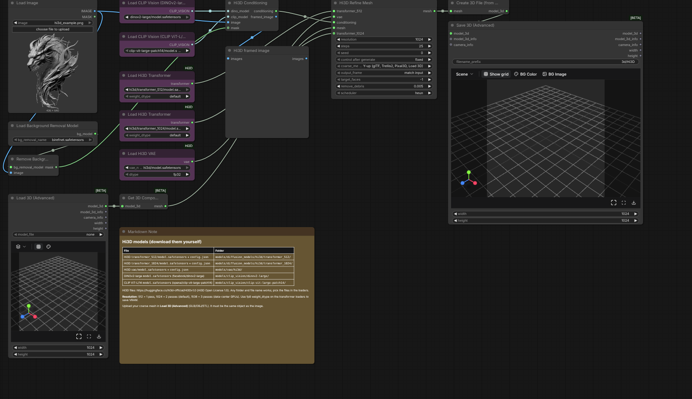

# ComfyUI-Hi3D

ComfyUI nodes for **[Hi3D v1.0](https://github.com/hi3d-official/Hi3Dv1.0)**: refine a coarse mesh into high-resolution geometry, conditioned on a reference image of the same object, at an effective sparse extraction grid of 512³, 1024³ or 1536³.

Hi3D is a refiner, so image-to-3D is two stages in one graph: any native coarse generator (Pixal3D, TRELLIS.2, Hunyuan3D) or a mesh you load produces the shape, and Hi3D adds the detail. The nodes follow the native Pixal3D/TRELLIS.2 workflow conventions: models are picked from ComfyUI's model folders, nothing is downloaded, and the result is a native `MESH` for Save 3D, Preview 3D and the mesh post-processing nodes.

This is an unofficial port, not an official Hi3D release. It is a pure-PyTorch reimplementation of the released inference code: no spconv, flash-attn or Triton, so it installs on any platform ComfyUI runs on.

[](assets/framework.png)

## Nodes

| Node | Does |
| --- | --- |
| **Load Hi3D Transformer** | Loads `transformer_512` or `transformer_1024` from `models/diffusion_models`, with a `weight_dtype` choice (default, fp16, bf16, fp32, fp8). |
| **Load Hi3D VAE** | Loads the sparse mesh VAE decoder from `models/vae`. |
| **Hi3D Conditioning** | Frames the subject by its mask exactly as the release does (square crop, white background, 1.2 padding) and encodes it with DINOv2-large and CLIP ViT-L/14 from two native **Load CLIP Vision** nodes. Also outputs the framed image for checking. |
| **Hi3D Refine Mesh** | Runs the refinement ladder (512 = 1 pass, 1024 = 2, 1536 = 3) on a `MESH` and returns a `MESH`. |

**Hi3D Refine Mesh** options:

- `resolution`: 512, 1024 or 1536. 1024 and 1536 also need `transformer_1024` connected.
- `steps` (25), `seed`: per-pass scheduler updates and the noise seed. Guidance follows the release's fixed schedule.
- `coarse_mesh_axes`: axis convention of the input mesh. Hi3D treats the image as the object's front, looking down −Z with Y up, which is what Trellis2, Pixal3D and Load 3D give you. Native **Hunyuan3D** `VoxelToMesh` output has X and Z swapped; choose that option for it. The output uses the same convention as the input.
- `output_frame`: `match input` puts the refined mesh where the coarse one was (same center and scale), so it lines up with texturing nodes; `normalized` centers it at the origin with unit radius, like the reference CLI.
- Advanced: `target_faces` (−1 = release default of 1M faces, 2M at 1536; 0 = no simplification), `remove_debris` (drop parts below this share of faces; 0.005 in the release), `scheduler` (`heun`, the release default, or `euler`).

Mesh batches are refined one item at a time, pairing mesh *i* with image *i*.

## Install

```bash
cd ComfyUI/custom_nodes
git clone https://github.com/susanoo1337/hi3dv1.0 ComfyUI-Hi3D
pip install -r ComfyUI-Hi3D/requirements.txt
```

The only extra dependency is `pyfqmr`, for the final simplification. Without it the full-resolution mesh is returned and logged. Use a recent ComfyUI (the V3 node API and the native `MESH` type); the native Pixal3D/TRELLIS.2 nodes used in the example workflow need ComfyUI 0.34 or newer.

## Models

Download the files yourself; nothing is fetched automatically. The folders below match the defaults in the example workflows, but any sub-folder and file name works: you pick each file in its loader.

| File | Put it in | Source |
| --- | --- | --- |
| `transformer_512/model.safetensors` + `config.json` (3.7 GB) | `models/diffusion_models/hi3d/transformer_512/` | [hi3d-official/Hi3Dv1.0](https://huggingface.co/hi3d-official/Hi3Dv1.0/tree/main) |
| `transformer_1024/model.safetensors` + `config.json` (3.7 GB, used for 1024 and 1536) | `models/diffusion_models/hi3d/transformer_1024/` | same |
| `vae/model.safetensors` + `config.json` (377 MB) | `models/vae/hi3d/` | same |
| `model.safetensors` of DINOv2-large | `models/clip_vision/dinov2-large/` | [facebook/dinov2-large](https://huggingface.co/facebook/dinov2-large) |
| `model.safetensors` of CLIP ViT-L/14 | `models/clip_vision/clip-vit-large-patch14/` | [openai/clip-vit-large-patch14](https://huggingface.co/openai/clip-vit-large-patch14) |

The loaders read the architecture from the weights and use a `config.json` beside them when present (it also tells the refine node which file is the 512 and which the 1024 transformer). Renamed single files work too, e.g. the output of `tools/convert_hi3d.py` below.

The encoders must be the exact ones named above: DINOv2-large without registers and OpenAI's CLIP ViT-L/14 at 224 px. The full CLIP `model.safetensors` (text and vision) loads fine; only the vision tower is used. The conditioning node rejects other encoder sizes.

### Precision and quantized weights

- `weight_dtype` on **Load Hi3D Transformer** sets the storage precision of the transformer's main layers. `fp8_e4m3fn` halves the VRAM of the 1.8B-parameter torso (3.7 GB to about 2 GB per transformer); `fp8_e4m3fn_fast` also uses fp8 matrix multiplication where the GPU supports it. Computation runs in fp16, as in the release, unless you pick `bf16` or `fp32`. Timestep, modulation and input/output projections always stay in fp32.
- Files already quantized in ComfyUI's formats (legacy scaled fp8, or `comfy_quant` fp8/int8/nvfp4/mxfp8) are detected and loaded with ComfyUI's quantized layers.
- `tools/convert_hi3d.py` repackages a downloaded release folder into single named files with the config embedded, optionally as bf16 or per-tensor scaled fp8 (`comfy_quant`):

  ```bash
  python tools/convert_hi3d.py /path/to/Hi3Dv1.0 /path/to/ComfyUI/models --dtype fp8_scaled
  ```

- GGUF is not supported.
- The VAE loader offers fp32 (release), fp16 and bf16.

## Workflows

Drag a file from `example_workflows/` onto the canvas (they also appear for this node pack in the template browser):

- **Hi3D Refine Mesh.json**: your image + your coarse mesh (Load 3D) → Hi3D → Save 3D. The shortest path.
- **Hi3D Image to 3D (Pixal3D).json**: ComfyUI's native Pixal3D template, stopped after its 512 shape stage, feeds Hi3D at 1024. Set *Switch to Trellis2* to make the coarse shape with TRELLIS.2 instead. A side-by-side preview shows the coarse mesh.
- **Hi3D Image to 3D (Hunyuan3D).json**: ComfyUI's native Hunyuan3D 2.0 subgraph makes the coarse mesh, as in the Hi3D release demo (which used Hunyuan3D-2mini). `coarse_mesh_axes` is preset for native Hunyuan3D meshes.

[](assets/workflow-refine-mesh.png)

Tips:

- The image and the coarse mesh must show the same object, seen from the front. Hi3D adds detail and fixes local shape; it keeps the coarse mesh's overall structure, including its mistakes. Hidden sides are plausible completion, not reconstruction.
- Give the conditioning node a foreground mask (Remove Background works). Without one the whole frame, background included, is encoded. The `MASK` output of Load Image is inverted alpha; put it through Invert Mask.
- Check the `framed_image` preview: it is exactly what the encoders see.
- Output is geometry only. With `output_frame` = `match input` the refined mesh keeps the coarse mesh's position and scale, so you can hand it to the native mesh post-processing and texturing nodes in place of the coarse one.

## Hardware

Hi3D is a 2 × 1.8B-parameter model with large sparse decodes. The upstream release validated the 1536³ ladder only on a 96 GB NVIDIA H20 and publishes no minimum for smaller cards. As a guide:

- Weights: about 3.7 GB per transformer in fp16 (about 2 GB in fp8) plus 0.4 GB for the VAE. The refine node asks ComfyUI for one transformer at a time and lets it move models between GPU and CPU as memory requires.
- Decoding dominates peak memory and grows several-fold per pass: 512 is the light setting, 1024 is the release default, 1536 targets data-center GPUs. As in the release, refinement stops with an error instead of starting another pass when a decode exceeds 12M voxels.
- No CUDA-only kernels: any device PyTorch supports should work. CPU works but is very slow.

## How it works

Each pass voxelizes the current mesh onto a 64³, 128³ or 192³ sparse grid (shrinking it if it would exceed 80k, 90k or 110k voxels), samples a 32-channel latent per voxel with the flow transformer (25 Heun steps; classifier-free guidance only at σ ≥ 0.7), decodes it with the self-pruning sparse VAE to an SDF eight times finer, and extracts a mesh with FlexiCubes. The next pass revoxelizes that mesh. The final mesh has small components removed and is simplified. See the [technical report](docs/Hi3D_v1.0_Technical_Report.pdf).

Differences from the reference implementation:

- Sparse convolution is a PyTorch gather-GEMM with spconv's weight layout and kernel convention; attention goes through ComfyUI's attention backend (PyTorch SDPA by default, or sage/flash/xformers when ComfyUI is launched with them). The Triton voxelizer is reimplemented in PyTorch.
- The encoders are ComfyUI's own DINOv2 and CLIP implementations. DINOv2's position embeddings are resized the way the release's `transformers` 4.46 did (ComfyUI's default differs slightly at 756 px); the conditioning node switches this for its own call only. ComfyUI stores CLIP Vision weights in fp16 by default; launch with `--fp32-text-enc` to keep them in fp32 like the release.
- Results are not bitwise reproducible across GPUs or attention backends, as in the release. The seed fixes the initial noise.

### Verification

This port was checked on CPU, without a GPU and without the released weights:

- Against the original `sparc3d` code with identical random weights: sparse convolution vs spconv 3.6e-7, transformer 2.2e-7 relative (including the RoPE rescaling used on 128³/192³ grids), VAE decode with identical voxel pruning and 2.4e-4 feature difference from its fp16 window attention, FlexiCubes extraction with identical faces, and voxelization identical to the reference Triton kernels.
- Conditioning through ComfyUI CLIP Vision vs the release's `transformers` encoders: 4.6e-4 relative, minimum token cosine similarity 0.9999997.
- Inside ComfyUI (CPU) with small random checkpoints: every node, one- and two-pass refinement, fp8 weight storage, a converted `comfy_quant` scaled-fp8 checkpoint, both axis conventions and both output frames, ending in Save 3D. The example workflows were built and validated in the ComfyUI frontend.

What is not verified here: output quality with the real weights, GPU memory use and speed. Please report results.

## Tests

```bash
pip install pytest
python -m pytest tests
```

The tests run on CPU with small random models: convolution against dense `conv3d`, voxelization, checkpoint loading, and the full ladder with a stand-in decoder that checks the output lands back on the input mesh.

## License

Hi3D code and weights are under the [Hi3D Open License Agreement Version 1.0](LICENSE); the TRELLIS, Pointcept, O-CNN and FlexiCubes portions keep their MIT and Apache-2.0 terms. See [NOTICE](NOTICE), [THIRD_PARTY_LICENSES.md](THIRD_PARTY_LICENSES.md) and [AUTHORS](AUTHORS), and [MODIFICATIONS.md](MODIFICATIONS.md) for what this port changed. DINOv2, CLIP and the coarse generators you combine it with have their own licenses.

Commercial products or services that integrate Hi3D must display **"Powered by Hi3D 1.0"** linking to [hi3d.ai](http://hi3d.ai/), and services above the scale thresholds in Section 5 need a separate license; read the Agreement. Generated meshes on their own do not carry these obligations.

Hi3D v1.0 builds on [Sparc3D: Sparse Representation and Construction for High-Resolution 3D Shapes Modeling](https://arxiv.org/abs/2505.14521).
